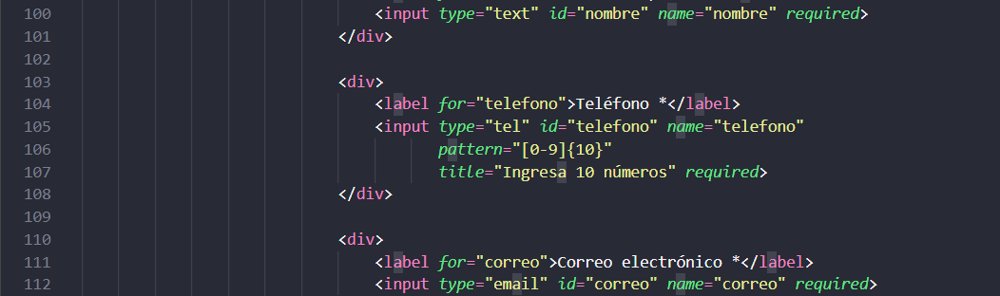
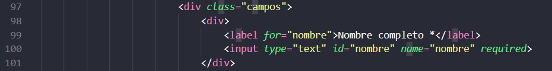
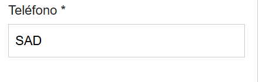
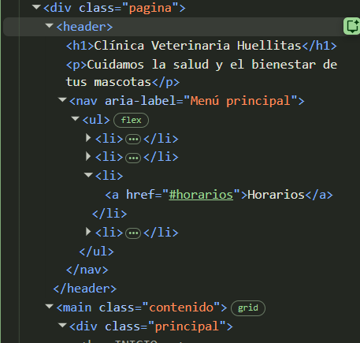
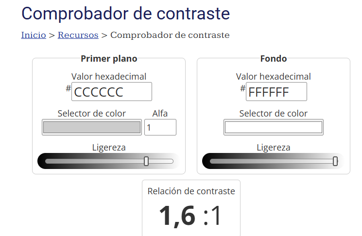
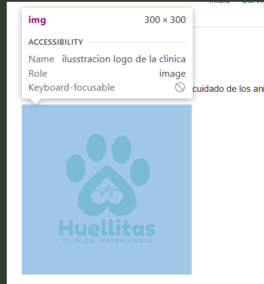

# Informe de Auditoría Web – Parte 2 (Laboratorio Cruzado)

* **Estudiante auditor:** Mateo Sebastián Namicela Jara
* **Estudiante auditado:** Cristian Gabriel Moscoso Tello
* **Fecha de auditoría:** 23 de octubre de 2026
* **Repositorio auditado:** https://github.com/Xristianz/Clinica-Veterinaria.git

---

## 1. Expectativas antes de la revisión

### 1.1 Requisitos base

| Requisito | Qué espero encontrar | Cómo lo verificaré |
|---|---|---|
| Base 1: estructura semántica | `header`, `nav`, `main`, al menos dos `section` o `article` con encabezado propio, `aside` y `footer`. Un solo `h1` y jerarquía de encabezados sin saltos. | Revisión del código y navegación por encabezados con Narrador (tecla H). |
| Base 2: formulario | Al menos 5 campos, cada uno con `label` cuyo `for` coincida con el `id` del campo. Tipos de `input` adecuados (`email`, `tel`, `number`, etc.). Validación nativa con `required`, `pattern` o `min`/`max`. Agrupación con `fieldset` y `legend`. | Revisión del código y árbol de accesibilidad: cada campo debe tener nombre accesible (Name). Envío del formulario vacío y con datos inválidos. |
| Base 3: tabla de datos | `caption`, `thead`, `tbody` y celdas de encabezado `th` con `scope`. | Revisión del código e inspector de elementos: los encabezados deben tener rol `columnheader` o `rowheader`. |
| Base 4: layout responsive | `display: grid` en la estructura general y `display: flex` en al menos un componente interno. Sin anchos fijos que causen scroll horizontal en 360 px. | Inspector de grid y flex de DevTools y modo responsive (Ctrl + Shift + M) a 360 px. |
| Base 5: colores | Colores declarados como variables `--color-...` en `:root` y usados con `var()`. Contraste mínimo de 4.5:1 en texto normal. | Panel Styles de DevTools y medición de contraste con el inspector de elementos. |
| Base 6: teclado y foco | Todos los elementos interactivos alcanzables con Tab en un orden lógico y con foco visible. Ningún `outline: none` sin reemplazo. | Recorrido completo de la página solo con teclado y búsqueda de `outline` en el CSS. |
| Base 7: validadores | Cero errores en el validador HTML del W3C y en el validador CSS. | validator.w3.org y jigsaw.w3.org/css-validator. |
| Base 8: imágenes | Cada `img` con `alt` que describa su contenido; `alt=""` solo en imágenes decorativas. | Revisión del código y lectura con Narrador. |

### 1.2 Requisitos personalizados (ficha N.º 18)

| Requisito | Qué espero encontrar | Cómo lo verificaré |
|---|---|---|
| Temática: clínica veterinaria | Todo el contenido (textos, tabla, formulario e imágenes) corresponde a una clínica veterinaria. | Revisión del contenido de la página. |
| Formulario: selección múltiple con `datalist` | Un `input` con atributo `list` que coincida con el `id` de un `datalist` con varias `option`, y un `label` asociado. Si usa el atributo `multiple`, debe estar en un `input type="email"` o `type="file"`, que son los únicos tipos donde es válido. | Clic y escritura en el campo para ver las sugerencias, navegación con flechas del teclado, árbol de accesibilidad y validador HTML. |
| Breakpoint: 1024 px | Una media query con `min-width: 1024px` (o `max-width: 1023px`) y un cambio visible del diseño en ese ancho. | Modo responsive de DevTools a 1023 px y a 1024 px. |
| Componente: hoja de estilos para impresión | Una regla `@media print` o una hoja enlazada con `media="print"` que oculte `nav` y `form`, sin ocultarlos en pantalla. | Vista previa de impresión (Ctrl + P) y emulación del tipo de medio `print` en DevTools (More tools → Rendering). |

---

## 2. Tabla de Hallazgos y Verificación de Requisitos

| N.° | Requisito | Ubicación (archivo y línea o selector) | Hallazgo | Norma que incumple | Evidencia | Severidad |
| :---: | :--- | :--- | :--- | :--- | :--- | :---: |
| **1** | **Base 1:** Estructura semántica completa y jerarquía de encabezados | `index.html`, líneas 16 a 239 (`header`, `nav`, `main`, `section`, `aside`, `footer`) | **Conforme.** La página incluye `header`, `nav`, `main`, cuatro `section` con encabezado `h2` propio, `aside` y `footer`. Tiene un único `h1` y la jerarquía de encabezados no presenta saltos de nivel. | N/A (Cumple especificación WHATWG y WCAG 2.2 Criterio 1.3.1) | Inspección de etiquetas semánticas en DevTools y esquema de encabezados (*outline*) del validador W3C. | N/A |
| **2** | **Base 2:** Formulario de al menos 5 campos con validaciones y asociación | `index.html`, líneas 92 a 220 (`form`, `fieldset`, `legend`, `input`, `select`, `textarea`) | **Conforme.** El formulario tiene 13 campos, todos con `<label>` asociado mediante `for` / `id`. Usa tipos adecuados (`tel`, `email`, `number`, `date`), validación nativa (`required`, `pattern`, `min`, `max`, `minlength`) y cuatro `<fieldset>` con su `<legend>`. | N/A (Cumple WCAG 2.2 Criterios 1.3.1 y 4.1.2) | Árbol de accesibilidad en DevTools: cada campo muestra su nombre accesible y cada `fieldset` aparece con rol `group` y el nombre de su `legend`. | N/A |
| **3** | **Base 2:** Identificación del propósito de los campos | `index.html`, líneas 100, 105 y 112 (`#nombre`, `#telefono`, `#correo`) | **No conforme.** Los campos de nombre, teléfono y correo electrónico no tienen el atributo `autocomplete`, por lo que el navegador no puede identificar su propósito ni ofrecer el autocompletado de datos personales. | WCAG 2.2 Criterio 1.3.5 (Identificar el propósito de la entrada, AA) | Captura de pantalla: [Ver evidencia 3](#evidencia-3) | Media |
| **4** | **Base 2:** Indicación de campos obligatorios | `index.html`, líneas 99 a 193 (`label` con `*`) | **No conforme.** Los campos obligatorios se marcan con un asterisco (`*`), pero la página no explica en ningún lugar qué significa ese símbolo. | WCAG 2.2 Criterio 3.3.2 (Etiquetas o instrucciones, A) | Captura de pantalla: [Ver evidencia 4](#evidencia-4) | Media |
| **5** | **Base 2:** Instrucciones de formato del teléfono | `index.html`, líneas 105 a 107 (`#telefono`, atributo `title`) | **No conforme.** El formato requerido (10 números) solo se indica en el atributo `title`, que no es visible salvo al pasar el mouse sobre el campo o al fallar la validación. No hay una instrucción visible junto al campo. | WCAG 2.2 Criterio 3.3.2 (Etiquetas o instrucciones, A) | Captura de pantalla: [Ver evidencia 5](#evidencia-5) | Baja |
| **6** | **Base 3:** Tabla de datos con `caption`, `thead`, `tbody` y `scope` | `index.html`, líneas 63 a 85 (`table`, `caption`, `thead`, `tbody`, `scope`) | **Conforme.** La tabla de horarios tiene `<caption>`, separación entre `thead` y `tbody`, y celdas de encabezado `th` con `scope="col"` y `scope="row"`. | N/A (Cumple WCAG 2.2 Criterio 1.3.1) | Inspector de elementos en DevTools: encabezados con rol `columnheader` y `rowheader`. | N/A |
| **7** | **Base 4:** Flexbox y ausencia de scroll horizontal a 360 px | `estilos.css`, líneas 50 a 57 (`nav ul`) | **Conforme.** El menú de navegación usa `display: flex` con `flex-wrap: wrap`. En emulación a 360 px no aparece scroll horizontal: imágenes con `max-width: 100%`, campos con `width: 100%` y sin anchos fijos que desborden. | N/A (Cumple WCAG 2.2 Criterio 1.4.10) | Simulador de dispositivos a 360 px en DevTools e inspector de Flexbox. | N/A |
| **8** | **Base 4:** Grid para la estructura general | `estilos.css`, líneas 70 a 75 (`.contenido`) | **Conforme con observación.** Grid se aplica a `main` (contenido principal y `aside`) y a los grupos de campos (`.campos`, líneas 130 a 134). Sin embargo, `header` y `footer` quedan fuera de la cuadrícula, por lo que la estructura general de la página no se organiza completamente con Grid. | Requisito base 4 de la consigna | Captura de pantalla: [Ver evidencia 8](#evidencia-8) | Baja |
| **9** | **Base 5:** Variables CSS y contraste de texto (4.5:1) | `estilos.css`, líneas 4 a 11 (`:root`) | **Conforme.** Todos los colores se declaran como variables (`--color-principal`, `--color-texto`, etc.) y no hay colores escritos directamente fuera de `:root`. El texto `#222222` sobre `#ffffff` tiene un contraste aproximado de 15.9:1, y los títulos `#155c55` sobre `#ffffff`, de 7.3:1. | N/A (Cumple WCAG 2.2 Criterio 1.4.3) | Medición de contraste con el inspector de elementos de DevTools. | N/A |
| **10** | **Base 5:** Contraste de los bordes de los campos | `estilos.css`, línea 8 (`--color-borde: #cccccc`) y línea 149 (`input, select, textarea`) | **No conforme.** El borde de los campos del formulario (`#cccccc` sobre `#ffffff`) tiene un contraste aproximado de 1.6:1, inferior al mínimo de 3:1 exigido para identificar componentes de interfaz. | WCAG 2.2 Criterio 1.4.11 (Contraste no textual, AA) | Captura de pantalla: [Ver evidencia 10](#evidencia-10) | Media |
| **11** | **Base 6:** Navegación por teclado y foco visible | `estilos.css`, líneas 167 a 174 (`:focus-visible`) | **Conforme.** Enlaces, botones y campos tienen foco visible con `outline: 3px solid var(--color-foco)` y `outline-offset: 3px`. El color de foco `#a44500` tiene un contraste aproximado de 6.1:1 sobre blanco. No se encontró ningún `outline: none`. Todos los elementos interactivos se alcanzan con Tab en un orden lógico. | N/A (Cumple WCAG 2.2 Criterios 2.1.1 y 2.4.7) | Navegación secuencial con la tecla Tab en el navegador. | N/A |
| **12** | **Base 7:** Cero errores en validadores W3C HTML y CSS | Archivos `index.html` y `css/estilos.css` | **Conforme.** Ambos archivos se sometieron al Nu Html Checker y al Jigsaw CSS Validator del W3C sin errores. | N/A (Cumple estándares W3C / WHATWG) | Verificación en el Nu Html Checker y en el Jigsaw CSS Validator del W3C. | N/A |
| **13** | **Base 8:** Imágenes con atributo `alt` adecuado | `index.html`, líneas 43 a 45 (`img[src="img/Logo.png"]`) | **No conforme.** El `alt` del logo (*"ilusstracion logo de la clinica"*) tiene un error ortográfico y no indica el nombre de la clínica, que es la información que transmite un logotipo. | WCAG 2.2 Criterio 1.1.1 (Contenido no textual, A) | Captura de pantalla: [Ver evidencia 13](#evidencia-13) | Baja |
| **14** | **Ficha 18:** Temática (Clínica veterinaria) | `index.html`, contenido general | **Conforme.** Todo el contenido (servicios, horarios, formulario de consulta y consejos) corresponde a una clínica veterinaria. | N/A | Revisión del contenido de la página. | N/A |
| **15** | **Ficha 18:** Campo especial de formulario (Selección múltiple con `datalist`) | `index.html`, líneas 191 a 216 (`#servicio1`, `#servicio2`, `#servicio3`, `datalist#lista-servicios`) | **Conforme.** Tres campos con el atributo `list="lista-servicios"` permiten seleccionar hasta tres servicios a partir de un `<datalist>` con cuatro opciones. El valor de `list` coincide con el `id` del `datalist` y cada campo tiene su `label`. | N/A (Cumple HTML Living Standard de WHATWG) | Interacción con el campo (sugerencias filtradas al escribir) y árbol de accesibilidad con rol `combobox`. | N/A |
| **16** | **Ficha 18:** Breakpoint principal de 1024 px | `estilos.css`, líneas 178 a 182 (`@media (max-width: 1024px)`) | **Conforme.** La media query usa el valor de 1024 px indicado en la ficha. En ese punto el diseño cambia entre una columna (contenido y `aside` apilados) y dos columnas. | N/A (Cumple especificación CSS Media Queries del W3C) | Verificación en modo responsive de DevTools a 1024 px y 1025 px. | N/A |
| **17** | **Ficha 18:** Componente especial (Hoja de estilos para impresión que oculte la navegación y el formulario) | `estilos.css`, líneas 186 a 194 (`@media print`) | **Conforme.** La regla `@media print` oculta `nav` y la sección del formulario (`#cita`) con `display: none`, y ambos siguen visibles en pantalla. | N/A (Cumple especificación CSS Media Queries del W3C) | Vista previa de impresión (Ctrl + P) y emulación del medio `print` en DevTools (Rendering). | N/A |
---

## 3. Evidencias

### Evidencia 3

Código de los campos nombre, teléfono y correo sin el atributo `autocomplete`.

### Evidencia 4

Formulario con campos marcados con asterisco, sin una instrucción que explique su significado.

### Evidencia 5

Campo de teléfono sin instrucción de formato visible.

### Evidencia 8

Inspector de Grid de DevTools: la etiqueta `grid` aparece solo en `<main class="contenido">`; `header` y `footer` quedan fuera de la cuadrícula.

### Evidencia 10

WebAIM Contrast Checker con `#cccccc` sobre `#ffffff`: contraste insuficiente para componentes de interfaz.

### Evidencia 13

Árbol de accesibilidad de DevTools con el nombre accesible del logo.

---

## 4. Conclusión

Se revisaron los 8 requisitos base y los 4 requisitos personalizados de la ficha 18, en 17 verificaciones. La página cumple con la estructura semántica, la tabla de datos, la navegación por teclado con foco visible, el uso de variables de color con contraste suficiente en el texto y la validación sin errores en los validadores del W3C. También cumple con todos los requisitos de su ficha: la temática de clínica veterinaria, la selección múltiple con `datalist`, el breakpoint de 1024 px y la hoja de estilos para impresión que oculta la navegación y el formulario.

Se registraron 6 hallazgos:

- **3 de severidad media:** la falta del atributo `autocomplete` en los campos de datos personales (fila 3), la falta de una explicación del asterisco en los campos obligatorios (fila 4) y el contraste insuficiente de los bordes de los campos del formulario (fila 10).
- **3 de severidad baja:** la instrucción de formato del teléfono, que solo aparece en el atributo `title` (fila 5), el uso de Grid solo en el contenido principal y no en toda la estructura de la página (fila 8) y el texto alternativo del logo, que tiene un error ortográfico y no indica el nombre de la clínica (fila 13).

Ningún hallazgo impide usar la página. Se recomienda corregir primero los de severidad media, porque afectan directamente a criterios de WCAG 2.2 nivel AA en el formulario, que es el componente donde el usuario interactúa con el sitio.
